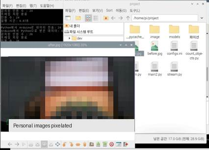
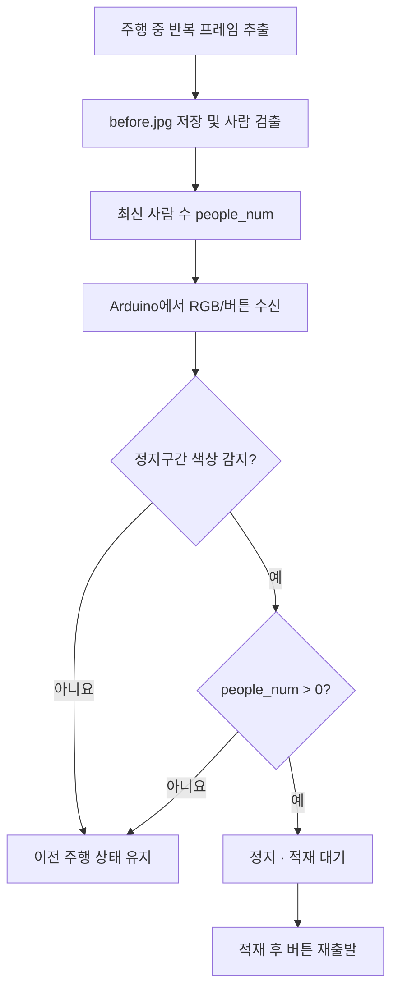

# 사람 인식 기반 라인트레이서 — 2023년 12월 대화 충실 복원본

> **2023년 당시 작성한 소스코드 원본 전문이 아닙니다.**
> 프로젝트 관련 과거 대화에서 확정된 코드·제어 규칙과 Safe Watch의 확인 가능한 사람 검출 소스를 근거로 복원한 최종 정리본입니다.
> 하드웨어가 없으므로 코드·논리·입출력 시뮬레이션만 검토합니다.


## Arduino 개발 스케치 7종 (사용자 제공 6종·후속 제안 1종)

실제로 제공된 Arduino 개발 코드 **6개**와 이번 대화의 **ChatGPT 후속 수정 제안 1개**를 구별해 보존했습니다. 제안 코드가 실제 Arduino에 업로드되었는지는 확인되지 않습니다. [스케치 보존 폴더](historical_snippets/)와 [버전별 검증 기록](docs/USER_SUPPLIED_ARDUINO_VERSIONS.md)에 **파일별로 원문 형태로 보관**했습니다.

- 제공된 스케치 여러 버전에서 **IR 센서 핀 7·8, PWM 5·6·9·10, 버튼 핀 3, 시리얼 9600bps**가 확인됩니다. 과거 코드 복원 시 임의로 가정했던 IR 핀 2·4보다 이 추가 증거를 우선합니다.
- RGB 원시값을 `map(raw, 0, 21504, 0, 1025)`로 변환하고, **300ms마다 통신을 검사하거나 1초마다 색상을 검사**하는 시험 버전이 있습니다. 이것을 최종 성능으로 단정하지는 않습니다.
- 시리얼 메시지 형식·`0/1`의 의미가 버전마다 달라 **기존 복원본의 `r:g:b:button` 계약이 유일한 최종 프로토콜이었다고 단정할 수 없습니다.**
- **6번 사용자 제공 스케치**에는 통신 시각 갱신 직후 100ms 경과 여부를 검사하는 **실행되지 않는 분기**가 있습니다. **7번 후속 제안 스케치**는 이 분기를 제거하고 `moving && receivedNumber == 0`일 때 `move()`하도록 바꿨습니다.
- 단, **7번도 버튼 입력 중 최대 약 300ms간 `move()`를 반복해 정지 처리가 지연될 수 있고**, `receivedNumber != 0`이 정지라는 점에서 기존 Python 재구성의 0/1 의미와 다릅니다. [버전별 검토](docs/USER_SUPPLIED_ARDUINO_VERSIONS.md)를 확인하세요.

**아래 통합 복원 코드(`arduino/line_tracer/line_tracer.ino`, `raspberry_pi/main.py`)는 원본 스케치와 별개입니다.** 어떤 스케치를 최종 실기기에 사용했는지는 아직 미확인입니다.

## Raspberry Pi Python 코드 정리

- [Pi 코드별 개발 흐름과 원본·수정 제안·복원본 구분](docs/PI_CODE_VERSIONS.md)
- [Pi 파일 안내](raspberry_pi/README.md)
- [실제 사용자 제공 시리얼 테스트 원문](historical_snippets/02_serial_echo_test.py)
- [Pi 역사적 코드 흔적의 범위](historical_snippets/PI_CODE_EVIDENCE.md)
- [**2023년 대화의 촬영 시점 근거**](docs/CAPTURE_TIMING_EVIDENCE.md)
- [**2023년 전체 개발대화 재대조 결과**](docs/CHAT_HISTORY_AUDIT.md)
- [**Pi–Arduino 시리얼 통신 실험과 오류 분석**](docs/PI_SERIAL_AND_DEBUG_HISTORY.md)

2023년 11월 23~28일 대화의 사용자 코드에서 **MJPEG 스트림 `get_frame()` → `count_objects.detect()` → Arduino 송수신**의 반복 순서를 확인했습니다. 정지구간 이후에야 촬영을 시작하는 분기는 없었습니다. 따라서 현재 Pi 복원은 **주행 중 반복 프레임 추출·검출을 먼저 수행하고, 이후 색상 센서의 정지구간 조건과 결합**합니다. 다른 기록에서 `send_data_to_arduino()`, `/dev/ttyACM0`, `9600bps` 등도 확인했습니다. **실제 최종 Pi `main.py` 전체 원문은 미확보**이며, 저장소의 `raspberry_pi/main.py`는 후대 복원본입니다.

## 프로젝트 개요

**특정 적재 구간에 사람이 대기하고 있을 때만 정지**하도록 Arduino 라인트레이서와 Raspberry Pi 카메라를 연계한 2023년 과제입니다. 같은 색상 구간이라도 대기자가 없으면 통과하고, 적재 후 버튼으로 재출발합니다. 이는 사용자가 2026-10-31 다시 명확히 확인한 개발 목적입니다. 사용자는 **실제 장치에서 사람 인식 후 정지 시험이 성공했다**고 확인했습니다. 다만 현재 공개된 통합 소스는 2023년 원문이 아닌 **2026년 대화 기반 복원본**이므로 당시 성공한 최종 프로그램과 동일하게 동작한다고 주장하지 않습니다.

- **Arduino**: IR 센서 라인 추종, TCS34725 색상 판별, 버튼, PWM 모터 제어
- **Raspberry Pi**: 2023년 사용자 코드에서는 `wlan0`의 IP를 읽고 `http://<ip>:8000/stream.mjpg`에서 OpenCV로 프레임을 추출·저장한 뒤 `count_objects.detect()`로 인원 확인 (저장 경로는 개발 버전별 차이)
- **시리얼**: Arduino → Pi `r:g:b:button`, Pi → Arduino `0`(정지) / `1`(주행 허용)
- **재출발**: 물품 적재 후 버튼을 다시 눌러 주행하며, 색상 센서의 정지 구간을 일정 시간 무시하도록 구현. 1~3초 범위를 시험했지만 최종 정확한 시간은 미확인
- **사람 인식**: 별도 모델을 학습한 것이 아니라 Safe Watch의 TensorFlow Lite 사람 검출 기능을 필요한 부분만 추려서 재사용


## 실제 시험 성공과 지연 문제 해결 (2023년 사용자 직접 확인)

**사람 인식 시 라인트레이서가 정지하는 실제 시험에 성공했습니다.** 다만 영상 인식 연산을 추가한 후 정지가 늦어져 **목표 적재 정지 구간을 지나치는 현상**이 발생했습니다. 이에 인식 연산을 간소화하고 **정지 구간보다 앞에서 감지하도록 조정**했습니다. 적재 후에는 **버튼을 다시 누르면 색상 기반 정지 조건을 일정 시간 무시하고 라인트레이싱을 재개**하도록 구성했습니다.

이 부분은 당시 실제 기기를 시험한 **사용자 직접 증언**에 기반합니다. 최적화 전후 지연시간, 인식 정확도, 반복 성공률 및 최종 실행 원문은 확보되지 않았습니다. [실제 시험·지연 개선 상세](docs/2023_FIELD_TEST_AND_LATENCY_IMPROVEMENT.md).

## 2023년 코드 재사용·통신 개발 화면

**Safe Watch의 객체 검출 코드를 추출해 라인트레이서에 사람 인식 기능을 적용하는 과정**의 화면들입니다. 당시 개발 흐름을 보여주는 자료이며, **이 사진만으로** 최종 라인트레이서의 자동 정지 성공률을 검증하는 것은 아닙니다. 실제 사람 인식 정지 성공은 별도 사용자 직접 확인에 근거합니다.





[화면별 근거와 해석 범위](docs/DETECTOR_REUSE_EVIDENCE.md)

## 당시 문답의 판단식과 실제 목적을 반영한 복원식

```python
color_condition = (r >= 4) or (r >= 2 * g) or (r >= 2 * b)
if button == 1:
    result = 1
elif (color_condition or people_num != 0) and button == 0:
    result = 0
else:
    result = previous_result
```

과거 기록의 `색상 OR 사람` 식은 **역사적 증거로 위에 그대로 남겨두었습니다.** 그러나 색 구간만으로 정지하기 때문에 실제 목적과 충돌합니다. 이에 현재 실행용 Pi 복원 코드에서는 아래 조건으로 수정했습니다.

```python
if button == 1:
    result = 1
elif color_condition and people_num != 0:
    result = 0
else:
    result = previous_result
```

| 작업 구간 | 대기자 | 주행 중 결과 |
|---|---|---|
| 밖 | 유무 무관 | 계속 주행 |
| 안 | 없음 | 계속 주행 |
| 안 | 있음 | **정지하여 적재 대기** |

한 번 멈추면 버튼을 다시 누르기 전까지 정지 상태를 유지합니다. 이 변경은 **2026년에 실제 목적을 명확히 반영한 복원 수정**이며 실제 2023년 최종 소스가 확인됐다는 뜻은 아닙니다. 색상 판정식의 `0:0:0` 문제, 감지 시작 구간과 적재 지점의 분리, 대기자 확인 ROI는 여전히 미확인입니다. [제어 로직 상세](docs/CONTROL_LOGIC_AUDIT.md).


## 폴더 구성

```text
arduino/line_tracer/line_tracer.ino  Arduino 측 코드 복원
raspberry_pi/main.py                Pi 측 순차 처리와 제어 로직 복원
raspberry_pi/count_objects.py       Safe Watch의 TFLite 사람 검출 부분을 추출한 복원
raspberry_pi/models/               모델 가중치 미확보 안내
raspberry_pi/image/                런타임 이미지 경로 안내
tests/                             상태·사람 수 판정 테스트
simulation/                        하드웨어 없는 시나리오
docs/                              출처, 확정/추정 구분, 누락 사항
```


## 장치 간 흐름도 (2023년 대화의 순서를 반영한 복원)



여기서 **연속 동영상 녹화**가 아니라 스트림에서 **한 프레임씩 반복 추출·인식**한 것이 당시 코드로 확인된 동작입니다. 검출 결과를 여러 반복에 걸쳐 캐싱했는지, 실제 검사 주기·ROI·정지 지점과 조기 검출 지점의 거리값은 미확인입니다. [원문 흔적 비교](docs/CAPTURE_TIMING_EVIDENCE.md).

## 추가 확인된 개발 단계의 차이

- **2023-11-24**에는 `current_result`가 달라질 때만 결과를 전송하도록 요청했습니다. 복원본은 매 수신에 응답하도록 작성돼 있으므로 이는 별도의 역사적 버전으로 기록했습니다.
- **2023-11-28**에는 `people_num`을 직접 전송하는 별도 시험이 있었고 `int.encode()` 오류와 `bytes([data])`/Arduino `Serial.parseInt()` 형식 불일치가 확인됐습니다. 해당 버전과 `result=0/1` 버전을 동일한 최종 소스로 합치지 않았습니다.
- **2023-11-16~17**에는 Uno 자체에 영상 AI를 넣으려던 시도가 있었지만 라이브러리 빌드 오류가 있었고, 실제 완성 프로젝트에서는 Pi가 인식을 담당한 것으로 구분했습니다.

[개발 대화의 날짜별 근거](docs/CHAT_HISTORY_AUDIT.md).

## 하드웨어 없이 실행 가능한 검증

```bash
python3 -m unittest discover -s tests -v
python3 simulation/trace.py
python3 -m py_compile raspberry_pi/main.py raspberry_pi/count_objects.py
```

실제 카메라/모델을 통한 추론에는 미확보된 `people_detect.tflite`와 해당 시스템의 라이브러리가 필요합니다. 하드웨어 구동·실측 성능은 검증하지 않았습니다.

## 확인된 부분과 가정한 부분

- 실제 경험으로 확인: 사람 인식 후 정지 시험 성공, 연산 지연에 의한 정지 구간 초과, 연산 간소화·감지 시작 시점 조정, 적재 후 버튼 재출발과 색상 정지 구간 일시 무시
- 대화·코드로 확인: 모터 PWM 핀 5/6/9/10, 버튼 핀 3, IR 입력 조합별 주행, 특정 시점의 RGB 시리얼 포맷·판단식, Safe Watch 사람 인식 기능 재사용
- 추가 스케치에서 확인: IR 핀 7/8과 9600bps, 한 버전의 RGB 변환 예시, 색상/사람·버튼·통신 응답을 조합하려 했던 개발 과정
- 여전히 추정: **최종 채택**된 IR 배선·RGB 스케일·0/1 회신의 의미·개행 방식·장치 경로, 카메라 호출 시점, 재출발 무시의 정확한 최종 시간, 당시 추출 함수의 반환값
- 배제: 비동기 워커, 현대식 상태 관리자, HOG 대체 감지, 미확인 자동 안전정지 정책 등 후대에 추가했던 설계

자세한 구분은 [확정·추정 목록](docs/CONFIRMED_VS_INFERRED.md), [처리 흐름·공백](docs/FLOW_AND_GAPS.md), [사람 감지·정지 영향 검증](docs/CONTROL_LOGIC_AUDIT.md)을 참고하세요.

## 정리 이력과 원본 출처

이 저장소는 **2023년 대화 충실 복원본 하나만 남긴 상태**입니다. 이전에 추가한 개선·재구성 코드 파일은 현재 브랜치에서 제거했으며 과거 Git 커밋 기록에만 남아 있습니다. 당시의 실제 라인트레이서 원본 파일을 찾았다는 뜻은 아닙니다.

Safe Watch 참조 코드: https://github.com/hsw-dotcom/safe-watch-crowd-monitoring/blob/main/src/python/count_objects.py

사람 검출 코드의 원래 기초에는 Evan Juras의 TensorFlow Lite 예제 코드가 사용되었습니다.

## 자동 오프라인 검증

[GitHub Actions — Offline reconstruction tests](https://github.com/hsw-dotcom/human-aware-line-follower/actions/workflows/offline-checks.yml)는 현재 **2026년 복원 코드**의 단위 테스트, 모의 시리얼 제어 흐름, Python 구문 검사를 수행합니다. 실기기 주행·사람 검출·제어 안정성을 검증하지 않습니다.
