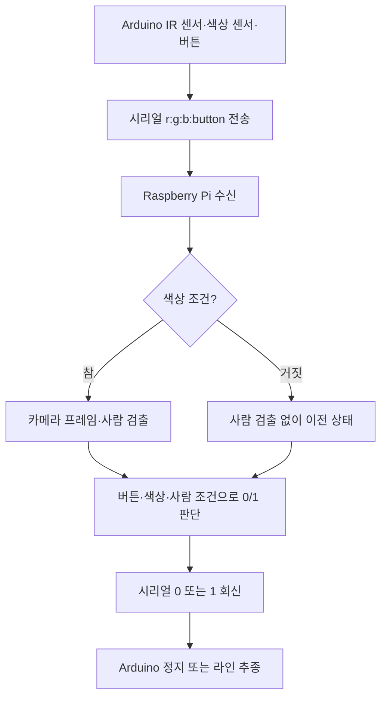

# 사람 인식 기반 라인트레이서 — 2023년 12월 대화 충실 복원본

> **2023년 당시 작성한 소스코드 원본 전문이 아닙니다.**
> 프로젝트 관련 과거 대화에서 확정된 코드·제어 규칙과 Safe Watch의 확인 가능한 사람 검출 소스를 근거로 복원한 최종 정리본입니다.
> 하드웨어가 없으므로 코드·논리·입출력 시뮬레이션만 검토합니다.

## 프로젝트 개요

기존 Arduino 라인트레이서에 Raspberry Pi 카메라를 연계해 **작업 구간의 사람 존재에 따라 정지시키려 한 2023년 과제**입니다. 현재 공개된 소스는 2023년 원문이 아닌 대화 기반 복원본이며, 실제 사람 감지가 정지 신호를 결정했는지는 별도 확인이 필요합니다.

- **Arduino**: IR 센서 라인 추종, TCS34725 색상 판별, 버튼, PWM 모터 제어
- **Raspberry Pi**: 카메라 프레임을 `before.jpg`로 저장하고 `count_objects.detect()`로 인원 확인
- **시리얼**: Arduino → Pi `r:g:b:button`, Pi → Arduino `0`(정지) / `1`(주행 허용)
- **재출발**: 버튼 입력 시 1을 회신, 이후 1~3초의 감지 무시 구간을 두도록 실험
- **사람 인식**: 별도 모델을 학습한 것이 아니라 Safe Watch의 TensorFlow Lite 사람 검출 기능을 필요한 부분만 추려서 재사용

## 확인된 핵심 판단식

```python
color_condition = (r >= 4) or (r >= 2 * g) or (r >= 2 * b)
if button == 1:
    result = 1
elif (color_condition or people_num != 0) and button == 0:
    result = 0
else:
    result = previous_result
```

**검증상 중요한 한계:** 위 조건은 `r=g=b=0`에서도 참입니다. 또한 **현재 복원본은 색상 조건이 참일 때만 사람 탐지를 호출하는데 그 색상 조건만으로 이미 정지(0)하기 때문에, 사람 감지 결과가 실제 반환값을 바꾸지 않습니다.** 이 문제가 2023년 당시 최종 프로그램에도 있었는지는 원본 미확보로 불명입니다. 제어식을 `AND`로 임의 변경하지 않았습니다. [판정 경로 검증](docs/CONTROL_LOGIC_AUDIT.md).

## 폴더 구성

```text
arduino/line_tracer/line_tracer.ino  Arduino 측 코드 복원
raspberry_pi/main.py                Pi 측 순차 처리와 제어 로직 복원
raspberry_pi/count_objects.py       Safe Watch의 TFLite 사람 검출 부분을 추출한 복원
raspberry_pi/models/               모델 가중치 미확보 안내
raspberry_pi/image/                런타임 이미지 경로 안내
tests/                             상태·사람 수 판정 테스트
simulation/                        하드웨어 없는 시나리오
docs/                              출처, 확정/추정 구분, 누락 사항
```


## 장치 간 흐름도 (2026년 기록 기반 복원)



**그림은 현재 복원 코드의 호출 흐름을 단순화한 것**이며, 당시 카메라 호출 시점은 미확인입니다. 특히 색상 조건이 참일 때 사람 수와 관계없이 정지되는 문제는 [검증 문서](docs/CONTROL_LOGIC_AUDIT.md)를 참고하세요.

## 하드웨어 없이 실행 가능한 검증

```bash
python3 -m unittest discover -s tests -v
python3 simulation/trace.py
python3 -m py_compile raspberry_pi/main.py raspberry_pi/count_objects.py
```

실제 카메라/모델을 통한 추론에는 미확보된 `people_detect.tflite`와 해당 시스템의 라이브러리가 필요합니다. 하드웨어 구동·실측 성능은 검증하지 않았습니다.

## 확인된 부분과 가정한 부분

- 확정: 모터 PWM 핀 5/6/9/10, 버튼 핀 3, IR 입력 조합별 주행, RGB 시리얼 포맷, 최종 판단식, Safe Watch 사람 인식 기능 재사용
- 추정: IR 물리 입력 핀, RGB 값 스케일, 시리얼 포트/속도/개행, 카메라 설정, 카메라 호출 시점, 재출발 무시의 정확한 최종 시간, 당시 추출 함수의 반환값
- 배제: 비동기 워커, 현대식 상태 관리자, HOG 대체 감지, 미확인 자동 안전정지 정책 등 후대에 추가했던 설계

자세한 구분은 [확정·추정 목록](docs/CONFIRMED_VS_INFERRED.md), [처리 흐름·공백](docs/FLOW_AND_GAPS.md), [사람 감지·정지 영향 검증](docs/CONTROL_LOGIC_AUDIT.md)을 참고하세요.

## 정리 이력과 원본 출처

이 저장소는 **2023년 대화 충실 복원본 하나만 남긴 상태**입니다. 이전에 추가한 개선·재구성 코드 파일은 현재 브랜치에서 제거했으며 과거 Git 커밋 기록에만 남아 있습니다. 당시의 실제 라인트레이서 원본 파일을 찾았다는 뜻은 아닙니다.

Safe Watch 참조 코드: https://github.com/hsw-dotcom/safe-watch-crowd-monitoring/blob/main/src/python/count_objects.py

사람 검출 코드의 원래 기초에는 Evan Juras의 TensorFlow Lite 예제 코드가 사용되었습니다.

## 자동 오프라인 검증

[GitHub Actions — Offline reconstruction tests](https://github.com/hsw-dotcom/human-aware-line-follower/actions/workflows/offline-checks.yml)는 현재 **2026년 복원 코드**의 단위 테스트, 모의 시리얼 제어 흐름, Python 구문 검사를 수행합니다. 실기기 주행·사람 검출·제어 안정성을 검증하지 않습니다.
