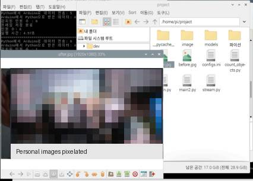
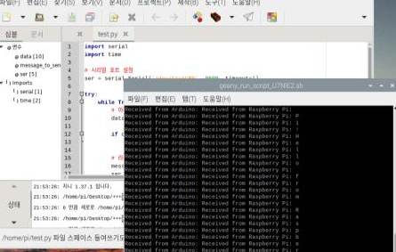

# 사람 인식 기반 라인트레이서
**Arduino + Raspberry Pi | 2023 캡스톤 디자인**

기존 IR 라인트레이서에 **대기자 인식 정지 및 적재 후 재출발** 기능을 추가한 프로젝트입니다. 지정 구간에 사람이 대기할 때만 멈추며, 사람이 없으면 그대로 통과합니다.

## 주요 기능

- **사람 인식 — Raspberry Pi:** 주행 중 카메라로 사람을 인식하고 약 **0.3초 주기**로 결과 갱신. 인원수 대신 `0=사람 없음, 1=사람 있음` 신호만 Arduino에 전달
- **정지구간 판별 — Arduino:** TCS34725 색상 센서로 구간을 식별. 바닥의 **라벨·테이프 색상과 재질**에 맞게 기준을 조정
- **주행·정지 — Arduino:** IR 센서 기반 라인 추종 중 **정지구간 + 사람 있음**이 모두 충족되면 정지. 이후 사람이 사라져도 정지 상태 유지
- **재출발 — Arduino:** 적재 후 버튼을 누르면 주행 재개. 잠시 **사람 신호와 색상 정지 조건을 모두 무시**하고 해당 구간을 통과

```text
Raspberry Pi                               Arduino
카메라 촬영·사람 검출                       IR 라인 추종
0.3초 주기 결과 갱신                      색상 센서로 정지구간 확인
사람 존재 0/1  ────────────────────────> 두 조건 결합
                                           ├─ 정지구간 + 사람 있음 → 정지·적재
                                           └─ 그 외 → 주행
                                         버튼 → 재출발(일시 조건 무시)
```

## 개발 및 문제 해결

기존 라인트레이서에 Raspberry Pi의 영상 인식 기능을 연계하고, Arduino–Pi 시리얼 통신과 정지·재출발 동작을 통합했습니다. **Safe Watch 프로젝트의 사람 검출 기능을 필요한 부분만 재사용**했습니다.

초기에는 영상 처리 지연으로 목표 정지 지점을 지나치는 문제가 있었습니다. **불필요한 인식 연산을 줄이고, 정지 지점보다 앞에서 사람을 인식하도록 조정**하여 실제 사람 인식 정지 시험을 수행했습니다. 적재 후 같은 구간에서 반복 정지하지 않도록 버튼 재출발 및 일정 시간 조건 무시 기능도 적용했습니다.

**사용 기술:** Python, OpenCV, TensorFlow Lite, Raspberry Pi, PySerial, Arduino C/C++, IR 센서, TCS34725.

## 코드 및 자료

| 경로 | 내용 |
|---|---|
| [`arduino/line_tracer/line_tracer.ino`](arduino/line_tracer/line_tracer.ino) | 색상 정지구간, 0/1 수신, IR 주행, 버튼 재출발 |
| [`raspberry_pi/main.py`](raspberry_pi/main.py) | 카메라 프레임 추출, 0.3초 인식 결과 갱신, 사람 존재 신호 전송 |
| [`raspberry_pi/count_objects.py`](raspberry_pi/count_objects.py) | TFLite 사람 검출 기능의 간소화된 복원 |
| [`tests/test_core.py`](tests/test_core.py) | 사람 존재 판단·전송 동작의 간단한 오프라인 테스트 |

## 개발 과정 자료

| 사람 검출 기능 연동 | Arduino–Pi 시리얼 시험 |
|---|---|
|  |  |

위 이미지는 **개발 과정의 일부 화면**입니다. 최종 차량 주행 성공률이나 정지 응답 시간을 증명하는 측정 자료는 아닙니다.

## 코드의 범위

이 저장소의 실행 코드는 **2023년 실사용 최종 원본이 아니라, 확보된 코드 조각과 개발 경험을 토대로 정리한 2026년 복원 예시**입니다. 원본 모델 가중치(`people_detect.tflite`)는 확보되지 않았고, 현재 하드웨어 재시험도 수행하지 않았습니다. 카메라 MJPEG 스트림·시리얼 장치·색상 임계값·재출발 무시 시간은 실제 환경에 맞게 설정해야 합니다.

오프라인 Python 검사:
```bash
python3 -m unittest discover -s tests -v
```

이전 Arduino 실험 코드와 상세 개발 기록은 기본 브랜치에서 제외했습니다. 필요한 경우 [정리 전 Git 커밋](https://github.com/hsw-dotcom/human-aware-line-follower/tree/fcee04c057d9add20f59e826142817da47c231eb)에서 확인할 수 있습니다.
